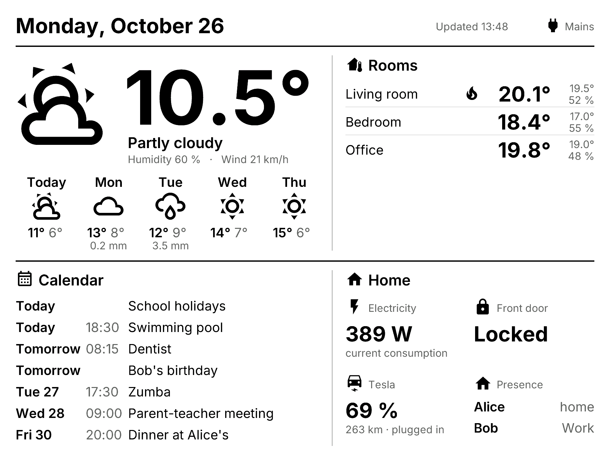
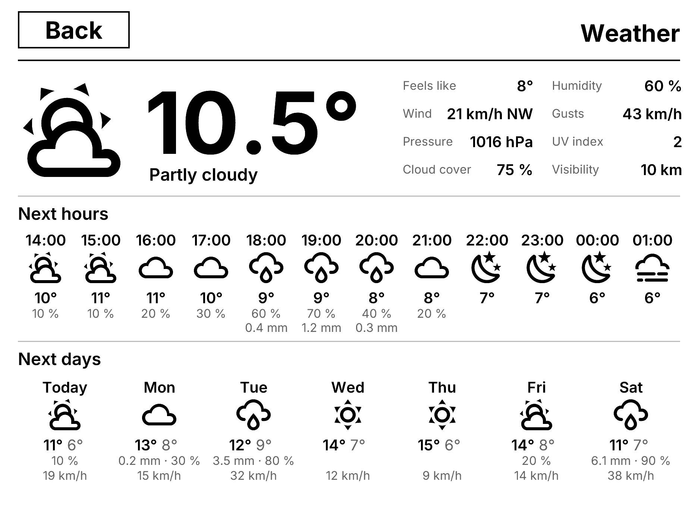
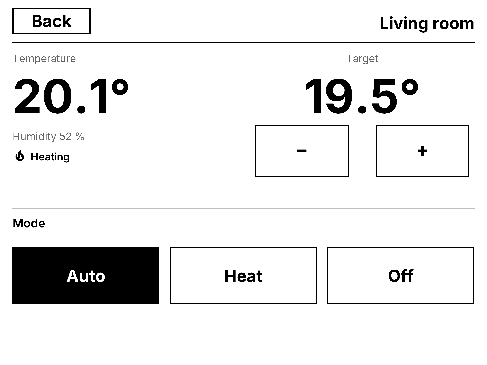
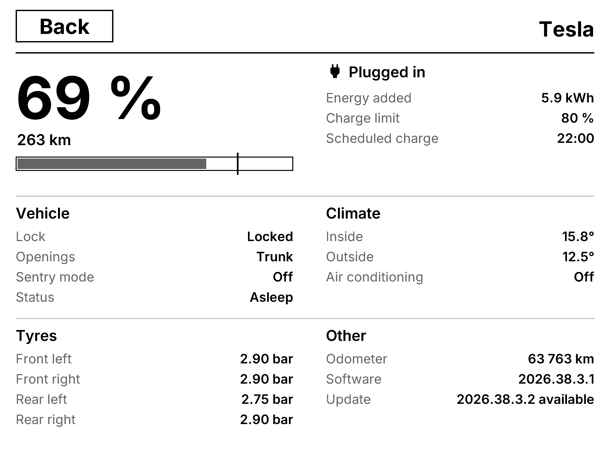
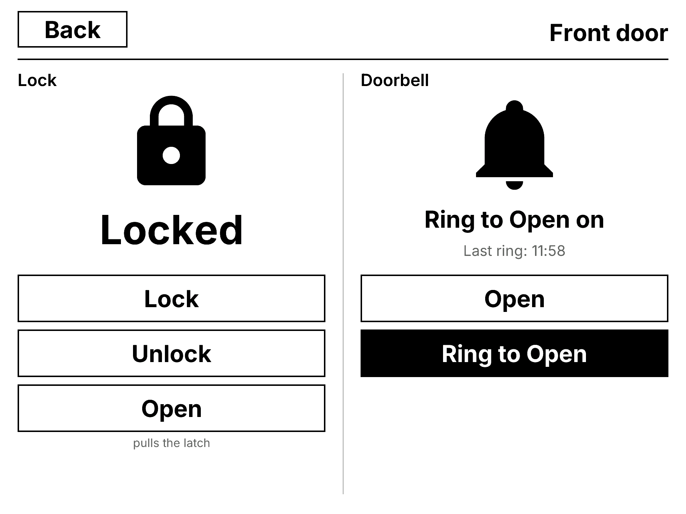

# reterminal-e1003-ha

[](https://github.com/vcanuel/reterminal-e1003-ha/actions/workflows/build.yml)

Home Assistant dashboard for the **Seeed reTerminal E1003** (10.3" ePaper, 1872×1404, 16 gray levels, GT911 touch),
in **plain ESPHome**: nothing to set up in Home Assistant besides allowing actions.



## Features

- Weather (current + 5 days) and calendar fetched with the HA actions `weather.get_forecasts` /
  `calendar.get_events` and `response_template`: no template sensor to create in HA.
- Rooms (climate.*), power, lock, electric car, presence through `homeassistant` sensors.
- Touch: weather sub-page (details, next 12 hours, next 7 days), room sub-page (target −/+, hvac mode), Tesla sub-page
  (TeslaMate: charge, vehicle, climate, tyres, software), lock sub-page (lock / unlock / open, with
  confirmation), feedback beep, back to the dashboard after 2 min.
  Touching anywhere else refreshes the screen.
- Power: mains/battery detection through the **SY6974B** charger (I2C 0x6B, REG08 bit 2), with a voltage-jump
  fallback. On mains: refresh every 5 min + touch. On battery: one refresh, then 30 min deep sleep
  (wake-up with the green button).
- On-screen texts in English or French (`language` substitution; see `ui_strings.h` to add a language).

## Layout of the repo

```
hardware.yaml        hardware package (display, touch, buzzer, LED, battery, charger, sleep, Wi-Fi/API/OTA)
fonts.yaml           shared fonts (Inter + Material Design Icons, downloaded at build time)
ui.h, ui_strings.h   drawing helpers, touch zones, sub-pages; on-screen texts per language
widgets/<name>.yaml  the widget's HA sensors, entities passed as vars
widgets/<name>.h     draws the widget inside a rectangle (+ touch zones / sub-page)
example.yaml         example screen, to copy into private/ (ignored by git) for your own screen
simulator.yaml       replaces hardware.yaml on a computer to render the screenshots (docs/)
```

| Widget | Package (vars) | Drawing |
|---|---|---|
| Header (date, last update, power) | `widgets/header.yaml` | `ui::header(it, {x, y, w, h})` |
| Weather, current + 5 days + sub-page | `widgets/weather.yaml` (`id`, `entity`) | `id(weather)(it, {x, y, 980, 620})` |
| Calendar | `widgets/agenda.yaml` (`id`, `calendars`, `title`, `duration`, `max_events`, `max_chars`) | `id(agenda)(it, {x, y, w, h})` |
| Room (climate.*) + sub-page | `widgets/room.yaml` (`id`, `entity`, `name`, `modes`, `step`), one per room | `ui::rooms(it, r, "Rooms", {id(living_room), ...})` |
| Power | `widgets/power.yaml` (`id`, `entity`, `title`, `subtitle`) | `id(power_meter)(it, {x, y, 370, 220})` |
| Lock + sub-page | `widgets/lock.yaml` (`id`, `entity`, `name`, `subtitle`) | `id(front_door)(it, {x, y, 370, 220})` |
| Electric car | `widgets/car.yaml` (`id`, `name`, `battery`, `range`, `charger_power`, `plugged`) | `id(car)(it, {x, y, 370, 220})` |
| Tesla (TeslaMate) + sub-page | `widgets/tesla.yaml` (`id`, `car`: entity prefix, `name`) | `id(car)(it, {x, y, 370, 220})` |
| Presence (person.*) | `widgets/person.yaml` (`id`, `entity`, `name`), one per person | `ui::presence(it, r, "Presence", {id(alice), ...})` |

Each package exposes a global `id(<id>)` that draws the widget inside the given rectangle; the screen file lists
its packages and places the widgets in a short lambda (see `example.yaml`):

```yaml
packages:
  hardware: !include hardware.yaml
  weather: !include { file: widgets/weather.yaml, vars: { id: weather, entity: weather.home } }
display:
  - id: !extend epaper_display
    lambda: |-
      if (ui::begin(it)) return;   // Wi-Fi setup screen or sub-page
      id(weather)(it, {40, 160, 978, 620});
```

Writing a widget: a `widgets/<name>.h` with a function `ui::<name>(Display &it, Rect r, ...)` (helpers `ui::txt`,
`ui::tile`, `ui::title`, `ui::zone` for a touch zone, `ui::open` for a sub-page, `ui::tr()` for translated texts),
and a `widgets/<name>.yaml` declaring its sensors and, if it calls an HA action on each refresh, adding it to the
shared script: `script: [{ id: !extend fetch_data, then: [...] }]`. Material Design icons: the `i_s` font of
`fonts.yaml`, to extend with `font: [{ id: !extend i_s, glyphs: [...] }]`. See [CONTRIBUTING.md](CONTRIBUTING.md).

## Usage

```bash
uv venv .venv && uv pip install --python .venv esphome      # ESPHome >= 2026.7 (it8951 driver)
cp secrets.example.yaml secrets.yaml                          # api_key, ota_password, ap_password
mkdir -p private && cp example.yaml private/my-screen.yaml    # private/ is ignored by git
# in private/my-screen.yaml: prefix the paths with ../ (hardware.yaml, widgets/...) and set your HA entities
.venv/bin/esphome run private/my-screen.yaml --device /dev/cu.wchusbserial*   # first flash over USB (CH340)
.venv/bin/esphome run private/my-screen.yaml --device <ip>                    # then over the air
```

1. On first boot the screen opens the `reTerminal-E1003` access point: pick your home Wi-Fi there.
2. HA discovers the device (ESPHome integration).
3. **ESPHome device options > "Allow the device to perform Home Assistant actions"** (otherwise weather and calendar
   stay empty, and the lock does not respond).

## Screenshots (simulator)

`simulator.yaml` replaces `hardware.yaml` with ESPHome's `host` platform and an in-memory display: it draws
`example.yaml` with demo data, saves the dashboard and the weather, room, car and lock sub-pages, then exits. No screen or Home Assistant
needed.

```bash
ESPHOME_SNAPSHOT_DIR=$PWD/docs .venv/bin/esphome -s name reterminal-sim -s hardware simulator.yaml run example.yaml --no-logs
for f in example example-weather example-room example-car example-lock; do sips -s format png docs/$f.bmp --out docs/$f.png && rm docs/$f.bmp; done   # macOS
```

 
 

## Known limitations

- Plugging in USB does not wake the screen (the charger interrupt reaches no GPIO): green button or next wake-up
  (≤ 30 min). For an OTA update on battery: plug in USB, then press the green button.
- Touch only works while awake, so in practice on mains.

## License and credits

Code under the [MIT](LICENSE) license. Contributions: see [CONTRIBUTING.md](CONTRIBUTING.md).

Fonts downloaded at build time, not included in the repo:
[Inter](https://rsms.me/inter/) (SIL Open Font License 1.1, via Google Fonts) and
[Material Design Icons](https://pictogrammers.com/library/mdi/) v7.4.47 (Apache 2.0, Pictogrammers).
Independent project, not affiliated with Seeed Studio, ESPHome or Home Assistant.
